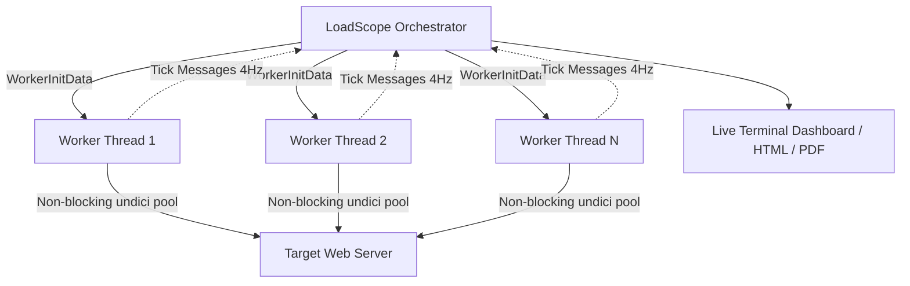
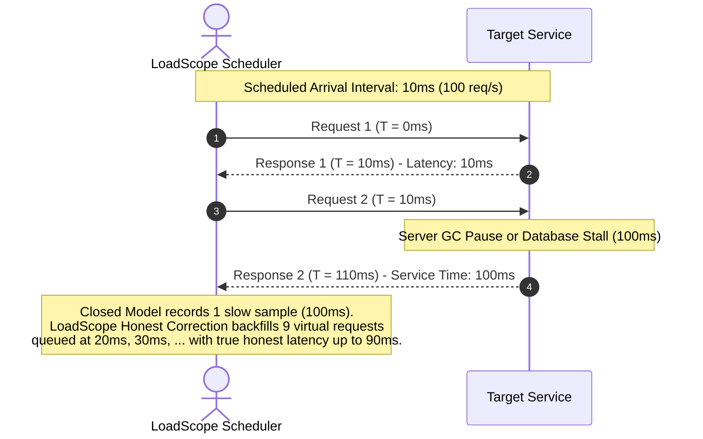
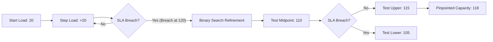

<div align="center">

# ⚡ LoadScope.

**A high-performance HTTP load tester with automated breaking-point finder, Coordinated Omission correction, CI performance regression gating, and zero-browser PDF/HTML reports.**

[](https://github.com/shaikafridd/loadscope/actions)
[](https://www.npmjs.com/package/loadscope)
[](https://www.typescriptlang.org/)
[](https://opensource.org/licenses/MIT)
[](https://nodejs.org/)

</div>

---

## 🚀 Why LoadScope?

Most modern load testing tools suffer from one of three major engineering shortcomings:
1. **Coordinated Omission**: Closed concurrency models stall the client when the server stalls, hiding catastrophic queueing delays behind polite client waits.
2. **Missing Automated Capacity Detection**: Finding maximum server capacity requires guessing parameters and manually running dozens of tests.
3. **Fragile CI & Heavy Reporting**: Generating visual reports traditionally pulls in 200MB+ Chromium binaries (Puppeteer/Playwright) or flaky remote CDNs.

**LoadScope fixes all three.** It provides:
- **Automated Breaking-Point Finder**: Stepped ramps combined with binary search bisection to discover the exact load where SLAs breach.
- **Honest Latency Modeling**: Open-model Poisson/Uniform arrival scheduling with Gil Tene Coordinated Omission correction.
- **CI Performance Regression Gate**: Save reference baselines, enforce directional tolerance budgets (e.g. max 10% p95 increase), and fail CI builds before merging slow code.
- **Zero-Browser Vector PDF & Interactive HTML Reports**: Lightning-fast (<100ms) vector PDFs via PDFKit and air-gapped, zero-CDN interactive HTML reports with embedded SVG charts.
- **Constant Memory ($O(1)$)**: Custom 260-bucket logarithmic histogram eliminating garbage collection pauses regardless of test duration or request count.

---

## ⚡ Quick Start

Execute immediately without installation using `npx`:

```bash
# Standard 10-second benchmark with 50 concurrent connections
npx loadscope http://localhost:3000/api -c 50 -d 10s

# Find maximum breaking-point capacity automatically
npx loadscope break http://localhost:3000/api --start 10 --max 200 --step 20 --max-p95 250

# Run open arrival model with Poisson distribution and Honest Latency
npx loadscope http://localhost:3000/api --rate 500 --distribution poisson --honest

# Generate a publication-grade vector PDF report
npx loadscope http://localhost:3000/api -c 50 -d 10s --pdf report.pdf

# Generate a self-contained interactive HTML report
npx loadscope http://localhost:3000/api -c 50 -d 10s --html
```

### 🖥️ Live Terminal Dashboard Experience

```text
 🚀 LoadScope v1.0.0  •  Target: http://localhost:3000/api  •  Workers: 4
 ────────────────────────────────────────────────────────────────────────
 Throughput:      3,480 req/s    [████████████████████░░░░░░░░░░]  70%
 Active Conns:    50 / 50        Dispatched: 34,800 reqs
 Latency (p50):   12.4 ms        Latency (p95): 38.6 ms  (p99: 89.2 ms)
 Error Rate:      0.00%          Event Loop Lag: 1.2 ms (Optimal)

 History (p95):   18ms ─── 22ms ─── 28ms ─── 35ms ─── 38ms ─── 39ms ─── 38ms
 ────────────────────────────────────────────────────────────────────────
```

### 🎯 Automated Breaking-Point Finder Experience

```text
 🔍 LoadScope Breaking-Point Capacity Detection:
 ────────────────────────────────────────────────────────────────────────
 [Step 1]  Load:  20 conn  │  3,850 req/s  │  p95:  18.2ms  │  Errors: 0.0%  │  ✅ PASS
 [Step 2]  Load:  40 conn  │  7,620 req/s  │  p95:  24.5ms  │  Errors: 0.0%  │  ✅ PASS
 [Step 3]  Load:  60 conn  │ 11,240 req/s  │  p95:  32.1ms  │  Errors: 0.0%  │  ✅ PASS
 [Step 4]  Load:  80 conn  │ 14,810 req/s  │  p95:  45.8ms  │  Errors: 0.0%  │  ✅ PASS
 [Step 5]  Load: 100 conn  │ 16,920 req/s  │  p95: 142.0ms  │  Errors: 0.0%  │  ✅ PASS
 [Step 6]  Load: 120 conn  │ 17,100 req/s  │  p95: 385.2ms  │  Errors: 0.2%  │  ❌ BREACH
 ────────────────────────────────────────────────────────────────────────
 ⚡ Binary Search Refinement: Narrowing capacity between 100 and 120...
 [Refine]  Load: 110 conn  │ 17,250 req/s  │  p95: 220.4ms  │  Errors: 0.0%  │  ✅ PASS
 [Refine]  Load: 115 conn  │ 17,180 req/s  │  p95: 295.1ms  │  Errors: 0.0%  │  ✅ PASS
 [Refine]  Load: 117 conn  │ 17,110 req/s  │  p95: 324.8ms  │  Errors: 0.1%  │  ❌ BREACH
 ────────────────────────────────────────────────────────────────────────
 🎯 Result: Maximum Safe Capacity is 115 concurrent connections (p95: 295.1ms)
```

---

## 📊 Feature Comparison Matrix

| Feature | LoadScope | autocannon | wrk | k6 |
| :--- | :---: | :---: | :---: | :---: |
| **Breaking-Point Finder** | ✅ Auto Stepped + Binary Search | ❌ Manual | ❌ Manual | ⚠️ Scripted |
| **Coordinated Omission Correction** | ✅ Built-in (Gil Tene) | ❌ Closed only | ❌ Closed only | ⚠️ Custom |
| **Open Arrival Model (Poisson)** | ✅ Native | ❌ | ❌ | ✅ |
| **CI Regression Gating & Step Summary**| ✅ Native (Exit 1 + PR Table) | ❌ | ❌ | ⚠️ Cloud/Thresholds |
| **Zero-Browser Vector PDF Reports** | ✅ Built-in (<100ms) | ❌ | ❌ | ❌ |
| **Air-Gapped Zero-CDN HTML Reports** | ✅ Built-in (SVG) | ❌ | ❌ | ⚠️ Cloud / Plugin |
| **Multi-Core Worker Threads** | ✅ Auto Core Scaling | ⚠️ Single thread | ✅ Multi-thread | ✅ Multi-thread |
| **Constant-Memory Histogram** | ✅ $O(1)$ Log Bucketed | ⚠️ HDR JS | ✅ C Struct | ⚠️ Go Runtime |
| **AI Performance Diagnostics** | ✅ Native Gemini/OpenAI | ❌ | ❌ | ❌ |

---

## 🏗️ Architecture

### 1. Multi-Core Worker Pool Dispatch
LoadScope scales traffic generation linearly across available physical CPU cores using Node.js Worker Threads with zero shared memory contention.



### 2. Gil Tene Coordinated Omission Correction
When a server stalls for 1 second, a closed-model load tester stops sending requests, recording a single slow sample while omitting hundreds of virtual users that should have queued. LoadScope backfills virtual requests according to the schedule:



### 3. Automated Capacity Detection (Stepped Ramp + Binary Search)


---

## 📖 CLI Usage & Command Reference

### Standard Load Test
```bash
loadscope <url> [options]
```

| Option | Flag | Default | Description |
| :--- | :--- | :---: | :--- |
| Concurrency | `-c, --concurrency <n>` | `10` | Number of simultaneous HTTP connections |
| Duration | `-d, --duration <duration>`| `10s` | Test duration (e.g. `10s`, `1m`, `300s`) |
| Workers | `-W, --workers <n\|auto>` | `1` | Worker threads count (`auto` detects logical cores) |
| Method | `--method <verb>` | `GET` | HTTP method (GET, POST, PUT, DELETE, etc.) |
| Headers | `-H, --header <h...>` | - | Custom HTTP headers (`-H "Authorization: Bearer token"`) |
| Body | `-b, --body <data>` | - | HTTP payload data string |
| Timeout | `--timeout <duration>` | `10s` | Individual socket timeout |
| Warmup | `--warmup <duration>` | `0s` | Warmup duration excluded from summary metrics |

### Open Arrival Model & Honest Latency
```bash
# Uniform open arrival at 400 req/s with Coordinated Omission correction
loadscope http://localhost:3000/api --rate 400 --honest

# Poisson arrival distribution (stochastic modeling) with TTFB tracking
loadscope http://localhost:3000/api --rate 500 --distribution poisson --ttfb --honest
```

### Breaking-Point Capacity Detection
```bash
loadscope break <url> [options]
```

```bash
# Automatically ramp from 10 to 200 connections, stepping by 10 every 5 seconds.
# Breaches if p95 latency exceeds 300ms or error rate exceeds 1%.
loadscope break http://localhost:3000/api \
  --start 10 \
  --max 200 \
  --step 10 \
  --step-duration 5s \
  --max-p95 300 \
  --max-errors 1.0 \
  --tolerance 2
```

### CI/CD Regression Gate
```bash
# 1. Capture reference performance baseline on main branch
loadscope http://localhost:3000/api -c 50 -d 15s --save-baseline baseline.json

# 2. In PR CI pipeline: evaluate against baseline (fails with exit code 1 if degraded)
loadscope http://localhost:3000/api -c 50 -d 15s \
  --baseline baseline.json \
  --max-p95-increase 10 \
  --max-rps-drop 5

# 3. Offline comparison between two JSON runs
loadscope compare current-run.json baseline.json --max-p95-increase 10
```

### Visual & Machine-Readable Exports
```bash
# Self-contained interactive HTML report (Zero CDN, air-gapped ready)
loadscope http://localhost:3000/api -c 50 -d 10s --html report.html

# Multi-page vector PDF benchmark report (<100ms render, zero Puppeteer)
loadscope http://localhost:3000/api -c 50 -d 10s --pdf report.pdf

# Vector PDF report with automated AI Performance Diagnostics
export GEMINI_API_KEY="your-gemini-key"
loadscope http://localhost:3000/api -c 50 -d 10s --ai-report report-ai.pdf

# Machine-readable JSON or CSV for monitoring pipelines
loadscope http://localhost:3000/api -c 50 -d 10s --json results.json --csv results.csv
```

---

## 💻 Programmatic TypeScript SDK

LoadScope provides a clean, fully-typed programmatic API for custom Node.js automation:

```typescript
import { run, runBreakingPoint, generatePdfReport, generateHtmlReport } from "loadscope";

// 1. Standard Benchmark Run
const summary = await run({
  url: "https://api.example.com/checkout",
  concurrency: 50,
  duration: 10,
  honest: true,
  workers: "auto",
});

console.log(`Throughput: ${summary.rps} req/s`);
console.log(`p95 Latency: ${summary.p95} ms`);
console.log(`Error Rate: ${(summary.errorRate * 100).toFixed(2)}%`);

// 2. Generate Interactive HTML & Vector PDF Reports
await generateHtmlReport(summary, "artifacts/report.html");
await generatePdfReport(summary, "artifacts/report.pdf");

// 3. Automated Breaking-Point Search
const bpResult = await runBreakingPoint({
  url: "https://api.example.com/checkout",
  start: 10,
  max: 300,
  step: 25,
  maxP95: 250,
  maxErrorRate: 0.01,
});

if (bpResult.breakingPointReached) {
  console.log(`Service saturated at ${bpResult.maxSustainedLoad} connections!`);
  console.log(`Breach reason: ${bpResult.breachReason}`);
}
```

---

## 🤝 Contributing

We welcome pull requests and issues! Please read our [Contributing Guide](CONTRIBUTING.md) for details on development workflows, test execution, and code style.

---

## 📄 License

This project is open-source software licensed under the [MIT License](LICENSE).
